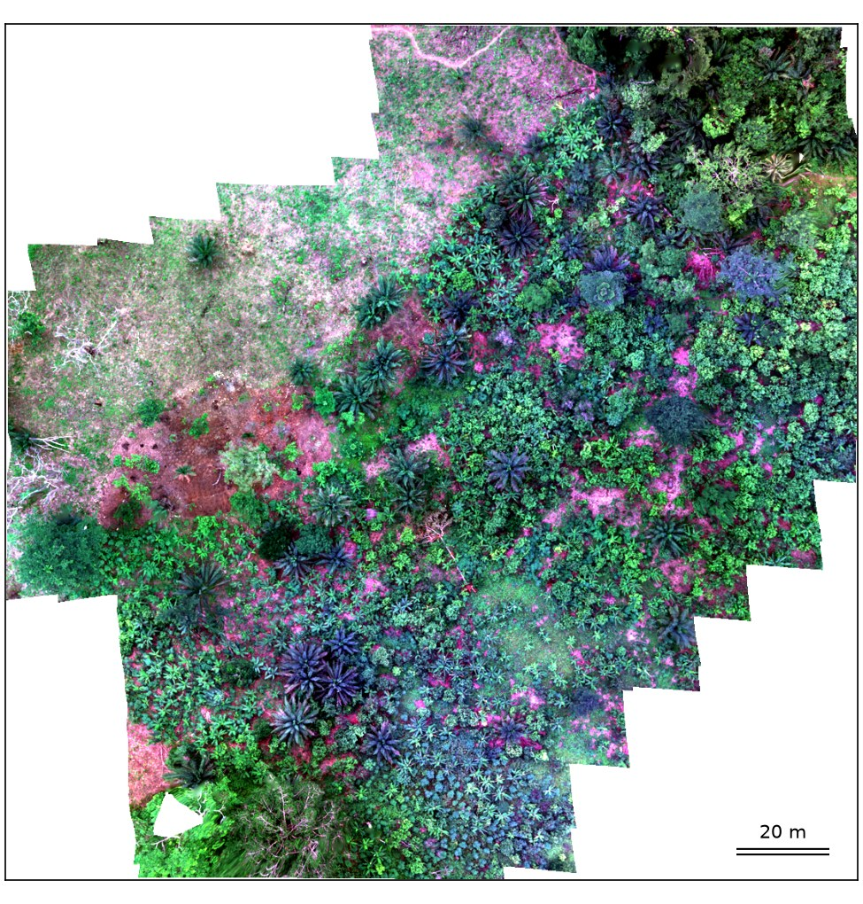
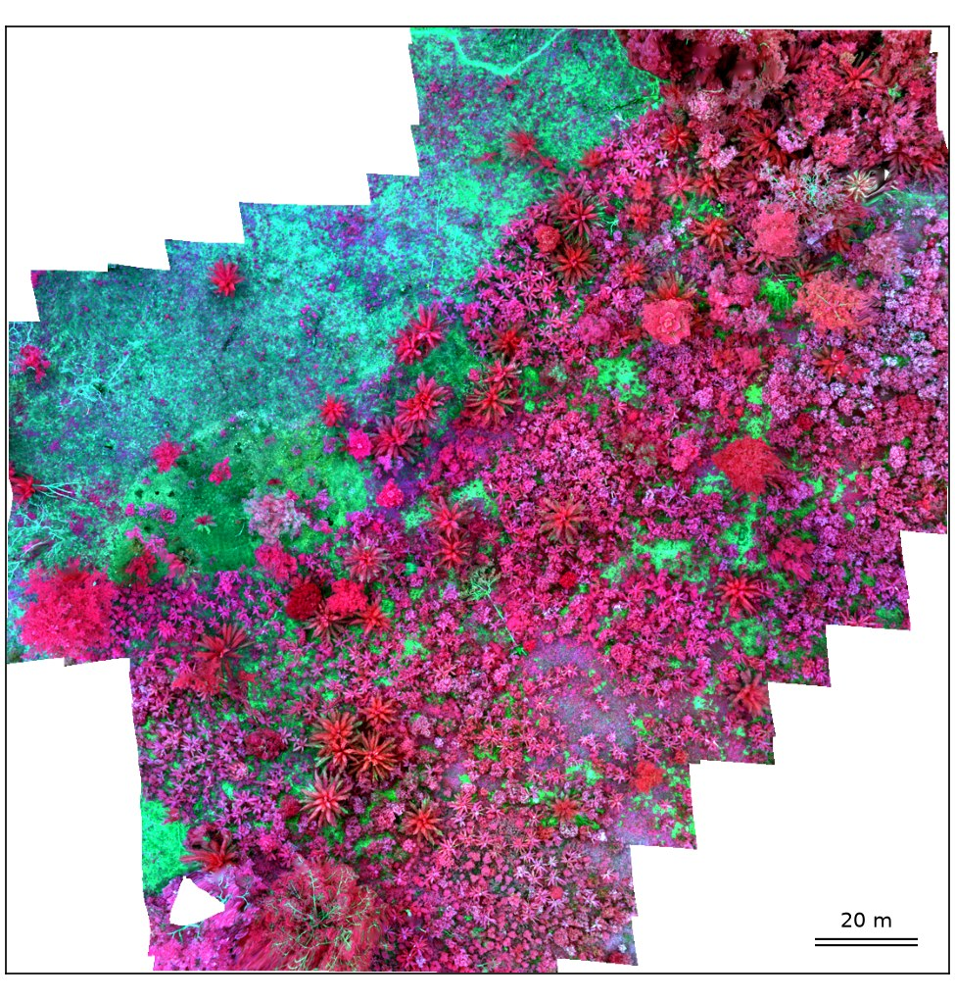
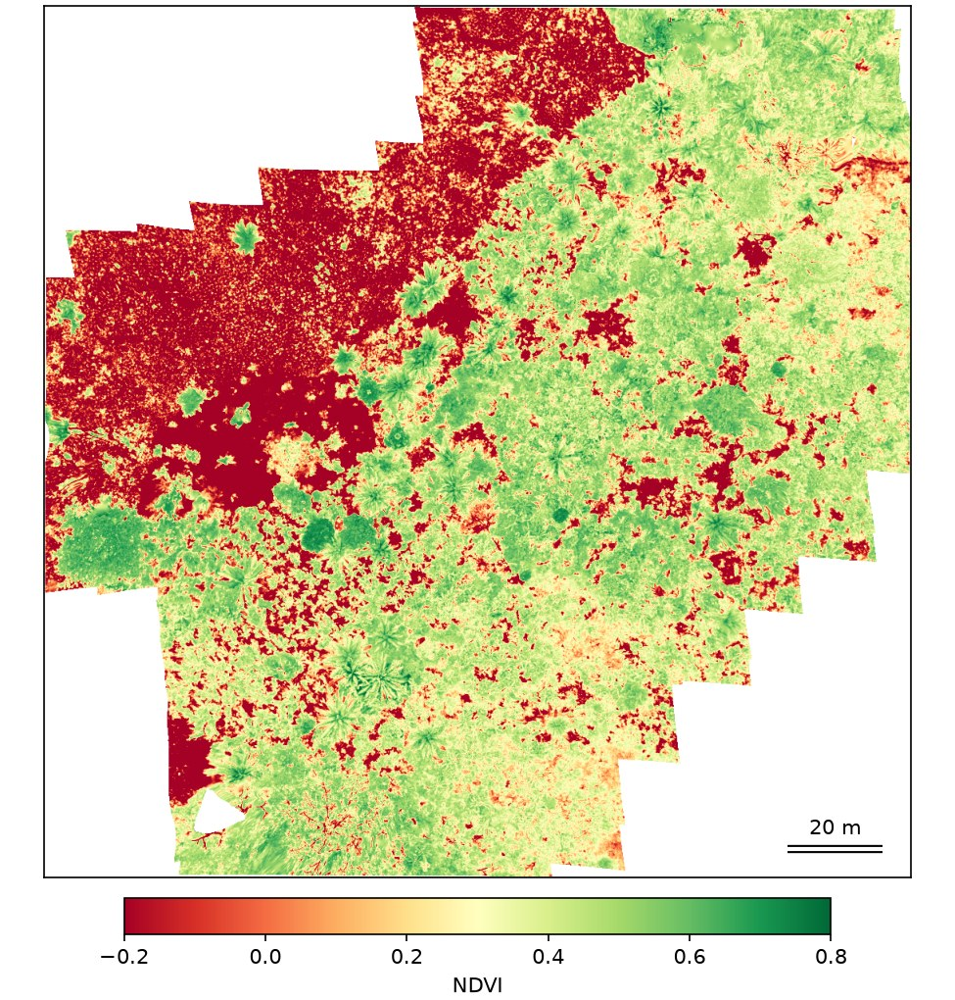
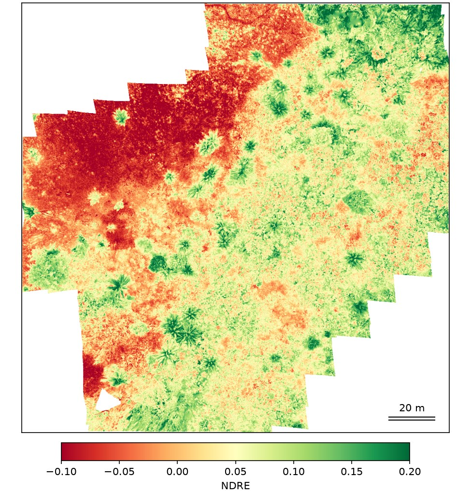
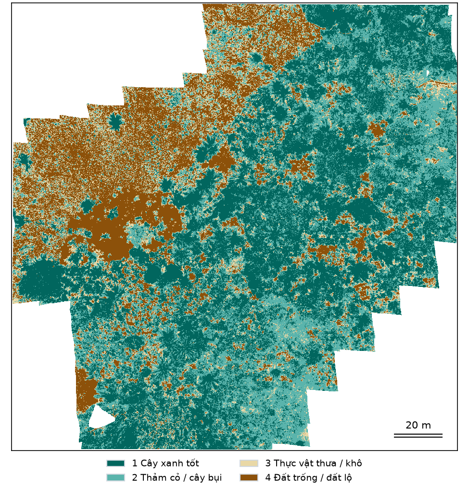
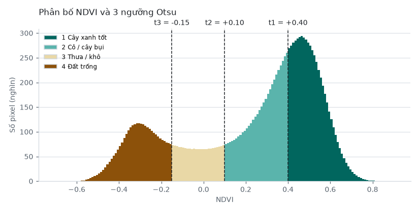
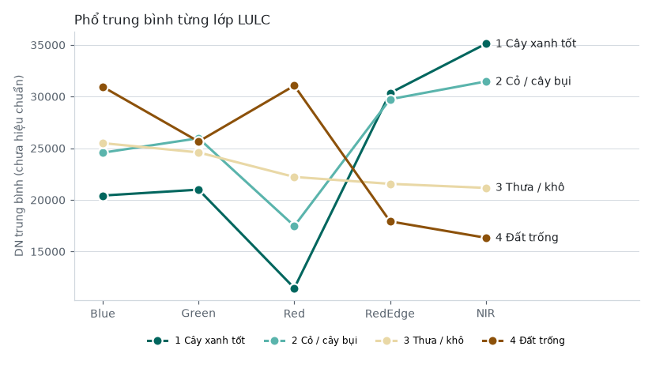
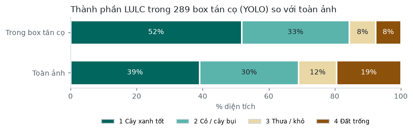
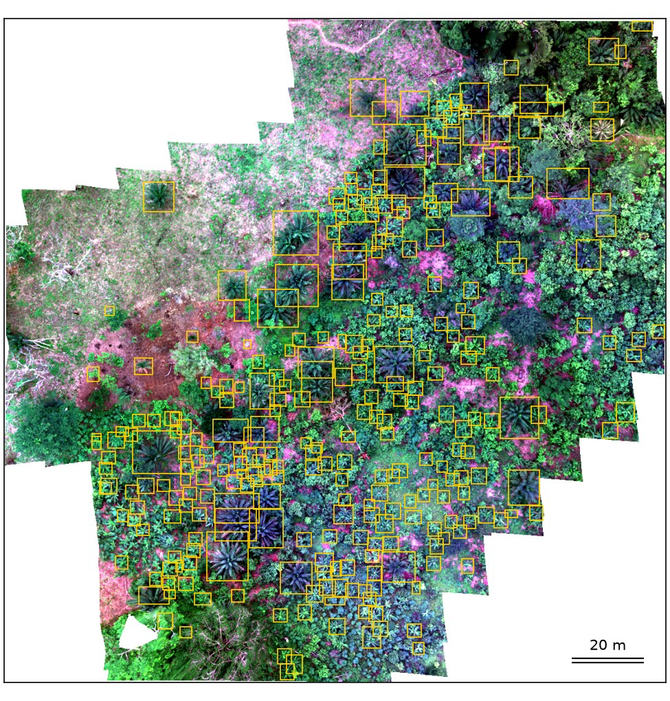
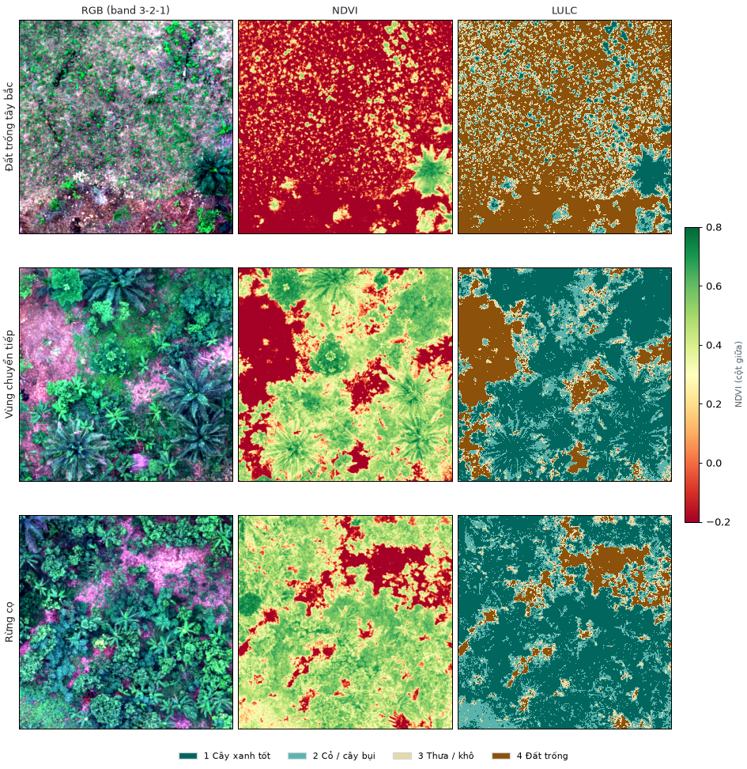

# [Bản nháp báo cáo] Giai đoạn 4 — Phân tích phổ NDVI/NDRE, phân lớp lớp phủ (LULC) và tính diện tích

*Người viết: Quang Anh. Minh ghép vào `BaoCao_DoAn.docx`. Hình nằm trong `docs/figures/`; số liệu lấy từ `data/outputs/lulc_summary.json`, `spectral_stats.json`, `spectral_qa.json`.*

---

## 4.1. Mục tiêu

Từ ảnh trực giao đa phổ 5 band, giai đoạn này (i) tính hai chỉ số thực vật NDVI và NDRE cho từng pixel, (ii) phân chia bề mặt khu vực thành các lớp phủ mặt đất (Land Cover) và (iii) tính diện tích thực tế của từng lớp theo m² và ha. Kết quả diện tích được xuất ra `lulc_summary.json` để dashboard WebGIS hiển thị.

## 4.2. Dữ liệu đầu vào

| Thuộc tính | Giá trị |
| :--- | :--- |
| Tệp | `data/outputs/cog_multispectral.tif` (đầu ra Giai đoạn 2) |
| Kích thước | 4419 × 4434 px (~182,5 × 183,1 m) |
| Band | 1 Blue, 2 Green, 3 **Red**, 4 **RedEdge**, 5 **NIR** (`uint16`) |
| CRS / pixel | EPSG:32630 (UTM 30N) / 0,0413 m |
| Mask | Nội bộ, 14 697 855 pixel hợp lệ (75,01%) |
| Mức xử lý bức xạ | DN thô, **chưa hiệu chuẩn phản xạ** (dataset không có ảnh tấm chuẩn) |

Script chỉ dùng band 3, 4, 5 và luôn gọi band bằng chỉ số tường minh, không suy ra từ số lượng band.

## 4.3. Cơ sở lý thuyết

### 4.3.1. Đặc trưng phản xạ phổ của thực vật

Lá xanh có hai đặc trưng phổ trái ngược nhau. Ở vùng **đỏ** (~650 nm), diệp lục hấp thụ mạnh ánh sáng để quang hợp, nên độ phản xạ thấp. Ở vùng **cận hồng ngoại** (NIR, ~840 nm), cấu trúc mô xốp nhiều khoảng khí bên trong lá tán xạ mạnh, nên độ phản xạ cao. Giữa hai vùng là **rìa đỏ** (red edge, ~700–750 nm), nơi độ phản xạ tăng vọt; vị trí và độ dốc của rìa đỏ nhạy với hàm lượng diệp lục. Đất trống không có bước nhảy này: phản xạ tăng đều theo bước sóng, Red và NIR chênh nhau ít. Mức chênh giữa NIR và Red vì vậy là thước đo lượng thực vật xanh.

### 4.3.2. Chỉ số NDVI

$$\text{NDVI} = \frac{\rho_{NIR} - \rho_{Red}}{\rho_{NIR} + \rho_{Red}} = \frac{B_5 - B_3}{B_5 + B_3} \tag{4.1}$$

Tử số đo mức chênh giữa NIR và Red. Mẫu số **chuẩn hóa** theo tổng độ sáng, nên NDVI ít phụ thuộc vào điều kiện chiếu sáng: một tán cây nửa nắng nửa bóng có hiệu NIR − Red khác nhau gấp đôi nhưng NDVI như nhau. NDVI luôn nằm trong [−1, 1]; càng gần 1 thực vật càng dày và khỏe. Hạn chế đã biết: NDVI **bão hòa** ở tán rất dày và bị ảnh hưởng bởi đất nền ở vùng cây thưa.

### 4.3.3. Chỉ số NDRE

$$\text{NDRE} = \frac{\rho_{NIR} - \rho_{RedEdge}}{\rho_{NIR} + \rho_{RedEdge}} = \frac{B_5 - B_4}{B_5 + B_4} \tag{4.2}$$

NDRE thay band đỏ bằng band rìa đỏ. Ánh sáng rìa đỏ ít bị hấp thụ và xuyên sâu vào tán hơn, nên NDRE ít bão hòa hơn NDVI và nhạy với hàm lượng diệp lục, thích hợp đánh giá sức khỏe cây trong vùng đã phủ xanh. Đổi lại, khoảng giá trị NDRE hẹp hơn nên kém hơn NDVI trong việc tách thực vật khỏi đất. Đề tài dùng **NDVI để phân lớp** và NDRE làm chỉ số bổ trợ.

### 4.3.4. Ảnh hưởng của dữ liệu chưa hiệu chuẩn phản xạ

Công thức (4.1), (4.2) được định nghĩa trên **độ phản xạ** ρ. Dữ liệu của đề tài là **DN** (số đếm thô của cảm biến), mỗi band có hệ số khuếch đại riêng. Do đó NDVI tính trên DN giữ đúng **thứ tự tương đối** (thực vật > thực vật thưa > đất) nhưng toàn bộ thang giá trị bị dịch: đất trống ở khu vực này cho NDVI khoảng −0,3 thay vì 0–0,2 như trên ảnh đã hiệu chuẩn. Hệ quả là **không dùng được ngưỡng lý thuyết** mà phải chọn ngưỡng theo phân bố của chính ảnh (mục 4.4.4). Kết quả NDVI/NDRE vì vậy chỉ có ý nghĩa tương đối trong phạm vi ảnh này.

## 4.4. Quy trình xử lý

Toàn bộ quy trình nằm trong `scripts/03_spectral_ndvi_analysis.py` (Python, rasterio + NumPy), chạy toàn ảnh trong khoảng 8 giây:

```
COG 5 band ─▶ kiểm tra CRS phẳng (mét) ─▶ đọc band 3, 4, 5 + mask
           ─▶ xác định pixel hợp lệ ─▶ NDVI, NDRE (float32, NaN = không hợp lệ)
           ─▶ phân lớp theo ngưỡng NDVI ─▶ đếm pixel × diện tích pixel
           ─▶ ndvi.tif, ndre.tif, lulc_class.tif, lulc_summary.json, spectral_stats.json
```

### 4.4.1. Xác định pixel hợp lệ

Một pixel được tính khi thỏa đồng thời ba điều kiện:

| Điều kiện | Lý do | Số pixel bị loại |
| :--- | :--- | ---: |
| Nằm trong mask | Ngoài vùng chụp | 4 895 991 |
| Không bão hòa (band 3, 4, 5 < 65535) | Giá trị thật vượt ngưỡng ghi của cảm biến 16-bit; Red bão hòa làm NDVI âm giả | 1 114 (0,008%) |
| Mẫu số khác 0 | Tránh phép chia 0/0 | 0 |

Còn lại **14 696 741 pixel** được tính chỉ số và phân lớp.

### 4.4.2. Tính chỉ số

Dữ liệu `uint16` được ép sang `float32` **trước** phép trừ; nếu trừ trực tiếp, hiệu âm sẽ bị tràn số (ví dụ 100 − 900 thành 64 736). Phép chia chỉ thực hiện trên pixel hợp lệ; pixel không hợp lệ được gán **NaN** thay vì 0, vì NDVI = 0 là một giá trị có nghĩa. Sai khác giữa kết quả float32 và phép tính đối chứng float64 nhỏ hơn 3·10⁻⁸. Các raster đầu ra giữ nguyên CRS và lưới pixel của COG nên chồng khít với ảnh gốc.

### 4.4.3. Hệ thống lớp phủ

Khu vực nghiên cứu là đồn điền cọ dầu xen rừng, có một khoảnh đất đã phát quang ở phía tây bắc; bề mặt chỉ gồm thực vật ở các mức độ che phủ khác nhau và đất trống. Hệ thống lớp được xây dựng theo dải chuyển tiếp từ tán dày đến đất lộ:

| Mã | Lớp |
| :---: | :--- |
| 1 | Cây xanh tốt / tán dày |
| 2 | Thảm cỏ / cây bụi |
| 3 | Thực vật thưa / khô |
| 4 | Đất trống / đất lộ |
| 0 | Không có dữ liệu |

### 4.4.4. Chọn ngưỡng bằng phương pháp Otsu phân tầng

Histogram NDVI có dạng **hai đỉnh** rõ rệt: đỉnh đất trống ở khoảng −0,33 và đỉnh thực vật ở khoảng 0,45, ngăn cách bởi một vùng thung lũng (Hình 4.6). Ngưỡng lý thuyết 0,45 rơi đúng vào đỉnh thực vật nên chia đôi tán cây một cách tùy tiện.

Đề tài dùng **phương pháp Otsu**: chọn ngưỡng *t* làm cực đại phương sai giữa hai nhóm

$$\sigma_B^2(t) = w_0(t)\, w_1(t)\, \left[\mu_0(t) - \mu_1(t)\right]^2 \tag{4.3}$$

trong đó *w₀, w₁* là tỉ lệ pixel và *μ₀, μ₁* là giá trị trung bình của hai nhóm dưới và trên *t*. Để có 3 ngưỡng cho 4 lớp, Otsu được áp dụng **phân tầng**:

1. Trên toàn bộ NDVI → *t₂* = 0,109 (thực vật / không thực vật);
2. Trong nhóm thực vật (NDVI > *t₂*) → *t₁* = 0,397 (tán dày / cỏ–cây bụi);
3. Trong nhóm không thực vật (NDVI ≤ *t₂*) → *t₃* = −0,174 (thực vật thưa–khô / đất trống).

Làm tròn tới bội số 0,05, luật phân lớp cuối cùng là:

| Lớp | Điều kiện |
| :--- | :--- |
| 1 Cây xanh tốt | NDVI > 0,40 |
| 2 Thảm cỏ / cây bụi | 0,10 < NDVI ≤ 0,40 |
| 3 Thực vật thưa / khô | −0,15 ≤ NDVI ≤ 0,10 |
| 4 Đất trống / đất lộ | NDVI < −0,15 |

Ba phương án ngưỡng đã được so sánh:

| Phương án | *t₁ / t₂ / t₃* | Lớp 1 | Lớp 2 | Lớp 3 | Lớp 4 |
| :--- | :--- | ---: | ---: | ---: | ---: |
| A — ngưỡng lý thuyết | 0,45 / 0,20 / 0,00 | 29,5% | 33,7% | 10,6% | 26,3% |
| B — k-means 4 cụm | 0,42 / 0,17 / −0,14 | 35,3% | 29,8% | 14,9% | 19,9% |
| **C — Otsu phân tầng** | **0,40 / 0,10 / −0,15** | **39,0%** | **30,1%** | **11,5%** | **19,4%** |

Phương án C được chọn vì: tán cây dày (kể cả tán cọ) được xếp trọn vào lớp 1 thay vì bị xé lốm đốm như A; các búi cỏ trên nền khô ở khu phát quang được tách thành lớp 3; B và C — hai phương pháp độc lập — cho kết quả gần nhau, chứng tỏ ngưỡng ổn định; và ngưỡng có cơ sở thống kê, tái lập được bằng lệnh `--suggest-thresholds`.

### 4.4.5. Tính diện tích

Vì ảnh ở hệ chiếu UTM với đơn vị mét, diện tích một pixel được đọc trực tiếp từ kích thước pixel:

$$S_{px} = |\Delta X \cdot \Delta Y| = 0{,}0413 \times 0{,}0413 = 0{,}00170569\ \text{m}^2 \tag{4.4}$$

$$S_k = N_k \cdot S_{px}, \qquad S_k[\text{ha}] = S_k[\text{m}^2] / 10\,000 \tag{4.5}$$

với *N_k* là số pixel của lớp *k*. Tỉ lệ phần trăm tính trên tổng diện tích hợp lệ, không tính trên khung chữ nhật của ảnh. Sai số do phép chiếu UTM tại khu vực (cách kinh tuyến trục khoảng 2,2°) dưới 0,1%, có thể bỏ qua.

## 4.5. Kết quả

### 4.5.1. Chỉ số NDVI và NDRE

| Chỉ số | min | p2 | median | mean | p98 | max |
| :--- | ---: | ---: | ---: | ---: | ---: | ---: |
| NDVI | −0,663 | −0,422 | 0,331 | 0,223 | 0,647 | 1,000 |
| NDRE | −0,253 | −0,111 | 0,037 | 0,034 | 0,181 | 0,532 |



*Hình 4.1. Ảnh trực giao màu tự nhiên (band 3-2-1) khu vực plot_B03.*



*Hình 4.2. Ảnh màu giả hồng ngoại CIR (band 5-3-2): NIR hiển thị bằng kênh đỏ nên thực vật hiện màu đỏ tươi.*



*Hình 4.3. Bản đồ NDVI. Khu phát quang phía tây bắc có NDVI âm; tán cọ hình sao nổi rõ với NDVI cao.*



*Hình 4.4. Bản đồ NDRE. Khoảng giá trị hẹp hơn NDVI; phân biệt rõ hơn mức độ xanh giữa các tán cây.*

### 4.5.2. Phân lớp và diện tích



*Hình 4.5. Bản đồ lớp phủ mặt đất 4 lớp (ngưỡng NDVI 0,40 / 0,10 / −0,15).*

| Lớp | Số pixel | Diện tích (m²) | Diện tích (ha) | Tỉ lệ |
| :--- | ---: | ---: | ---: | ---: |
| 1 Cây xanh tốt | 5 732 176 | 9 777,32 | 0,9777 | 39,00% |
| 2 Thảm cỏ / cây bụi | 4 416 859 | 7 533,79 | 0,7534 | 30,05% |
| 3 Thực vật thưa / khô | 1 692 116 | 2 886,23 | 0,2886 | 11,51% |
| 4 Đất trống / đất lộ | 2 855 590 | 4 870,75 | 0,4871 | 19,43% |
| **Tổng** | **14 696 741** | **25 068,08** | **2,51** | **100%** |

Thực vật (lớp 1 + 2) chiếm khoảng 69% diện tích, tập trung ở nửa phía đông và nam; đất trống tập trung ở khoảnh phát quang phía tây bắc.



*Hình 4.6. Histogram NDVI toàn ảnh và ba ngưỡng Otsu; màu cột theo lớp.*

## 4.6. Kiểm định chất lượng

Do không có dữ liệu thực địa, kết quả được kiểm định gián tiếp bằng script `scripts/qa_spectral.py` gồm **18 kiểm tra, tất cả đạt**.

| Nhóm | Nội dung | Kết quả |
| :--- | :--- | :--- |
| Diện tích (6) | Diện tích pixel đọc từ transform; số pixel phân lớp = mask − bão hòa − mẫu số 0; số pixel trong JSON = đếm trên raster; tổng 4 lớp = tổng hợp lệ | Khớp tuyệt đối (sai số làm tròn 0,01 m²) |
| Nhất quán (4) | NaN trong NDVI trùng lớp 0; phân lớp lại từ `ndvi.tif` khớp `lulc_class.tif`; NDVI ∈ [−1, 1]; Otsu tính lại cho đúng ngưỡng | 0 pixel lệch |
| Phổ từng lớp (5) | NDVI và tỉ số NIR/Red giảm dần lớp 1 → 4; lớp 1 có NIR cao nhất, Red thấp nhất; lớp 4 có Red > NIR | Đúng lý thuyết |
| Đối chiếu RGB (1) | Tương quan NDVI với chỉ số xanh ExG chỉ dùng kênh nhìn thấy | Pearson r = 0,638 |
| Đối chiếu YOLO (2) | Thành phần lớp bên trong 289 box tán cọ của nhánh AI | 84,4% là lớp 1 + 2 |



*Hình 4.7. Phổ DN trung bình của 4 lớp. Lớp 1 có Red thấp nhất, NIR cao nhất và bước nhảy rìa đỏ rõ nhất; lớp 4 có phổ dốc xuống, đặc trưng đất trống.*

**Đối chiếu với nhánh AI.** Hai nhánh dùng hai phương pháp độc lập — học sâu trên ảnh RGB và ngưỡng phổ NDVI. Rasterize 289 box tán cọ lên lưới LULC cho thấy lớp 1 chiếm 51,7% trong box (so với 39,0% toàn ảnh) và lớp đất chỉ 7,6% (so với 19,4%). Phần ~15% không phải thực vật là hợp lý vì box hình chữ nhật bao quanh tán tròn.



*Hình 4.8. Thành phần lớp phủ bên trong box tán cọ (YOLO) so với toàn ảnh.*



*Hình 4.9. 289 tán cọ dầu phát hiện bằng YOLO chồng lên ảnh RGB.*



*Hình 4.10. Đối chiếu RGB – NDVI – LULC trên ba vùng 29 × 29 m: khu đất trống tây bắc, vùng chuyển tiếp và rừng cọ.*

**Độ nhạy theo ngưỡng.** Dịch từng ngưỡng ±0,05: *t₂* và *t₃* nằm ở vùng thung lũng của histogram nên diện tích chỉ đổi ±2,4–2,7 điểm phần trăm; *t₁* nằm sát đỉnh thực vật nên nhạy hơn, ±8,3–9,5 điểm phần trăm, chỉ chuyển diện tích giữa lớp 1 và lớp 2. Tổng diện tích thực vật (lớp 1 + 2) không đổi khi dịch *t₁*.

**Bóng đổ.** Trong 5% pixel tối nhất, 45,3% thuộc lớp 1 và 29,6% thuộc lớp 2, chỉ 8,7% thuộc lớp đất: bóng chủ yếu nằm trong tán và NDVI, do là tỉ số, vẫn nhận diện được thực vật.

## 4.7. Thảo luận và hạn chế

- **Dữ liệu chưa hiệu chuẩn phản xạ.** NDVI/NDRE chỉ có ý nghĩa tương đối; ngưỡng gắn với ảnh này. Với dữ liệu khác hoặc sau khi hiệu chuẩn, cần tính lại ngưỡng bằng `--suggest-thresholds`.
- **Chưa có ground truth.** Độ chính xác chưa được định lượng bằng ma trận nhầm lẫn, Overall Accuracy hay Kappa; các kiểm định ở mục 4.6 là gián tiếp.
- **Ranh giới lớp 1/2 mềm.** Diện tích lớp 1 và 2 nên được hiểu kèm sai số ±8–10 điểm phần trăm theo ngưỡng *t₁*.
- **Phân lớp theo pixel.** Pixel ở mép tán (lẫn lá và đất) dễ rơi vào lớp 2–3, tạo hiệu ứng lốm đốm.

**Hướng phát triển:** hiệu chuẩn phản xạ bằng tấm chuẩn; lấy mẫu kiểm định và lập ma trận nhầm lẫn; thử các chỉ số giảm ảnh hưởng đất nền (SAVI, MSAVI) hoặc ít bão hòa (EVI); phân loại có giám sát (Random Forest) trên cả 5 band; tính NDVI/NDRE trung bình cho từng tán cọ để đánh giá sức khỏe từng cây.

## 4.8. Tái lập kết quả

```bash
python scripts/03_spectral_ndvi_analysis.py          # NDVI, NDRE, LULC, diện tích (~8 s)
python scripts/03_spectral_ndvi_analysis.py --suggest-thresholds   # tính lại ngưỡng Otsu
python scripts/qa_spectral.py                        # 18 kiểm tra chất lượng (~8 s)
python -m pytest tests -q                            # 37 unit test trên dữ liệu giả lập
```

Notebook `notebooks/04_demo_pipeline.ipynb` trình diễn toàn bộ kết quả (RGB, CIR, NDVI, NDRE, LULC, tán cọ) trong khoảng 6 giây và xuất các hình 4.1–4.5, 4.9 vào `docs/figures/`.

---

### Danh mục hình

| Hình | Tệp | Nguồn |
| :--- | :--- | :--- |
| 4.1 | `figures/demo_rgb.jpg` | notebook |
| 4.2 | `figures/demo_cir.jpg` | notebook |
| 4.3 | `figures/demo_ndvi.jpg` | notebook |
| 4.4 | `figures/demo_ndre.jpg` | notebook |
| 4.5 | `figures/demo_lulc.png` | notebook |
| 4.6 | `figures/spectral_qa_histogram.png` | `qa_spectral.py` |
| 4.7 | `figures/spectral_qa_profile.png` | `qa_spectral.py` |
| 4.8 | `figures/spectral_qa_palm.png` | `qa_spectral.py` |
| 4.9 | `figures/demo_palm_overlay.jpg` | notebook |
| 4.10 | `figures/spectral_qa_crops.png` | `qa_spectral.py` |
