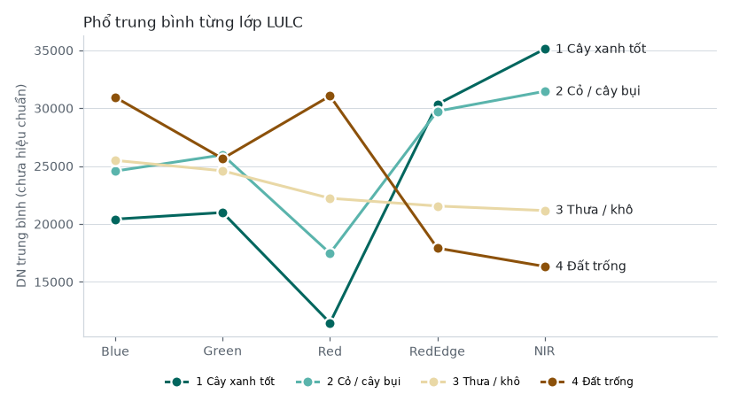
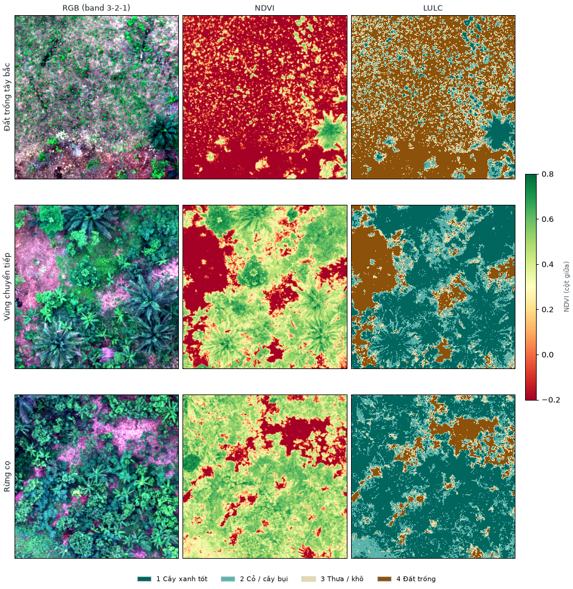
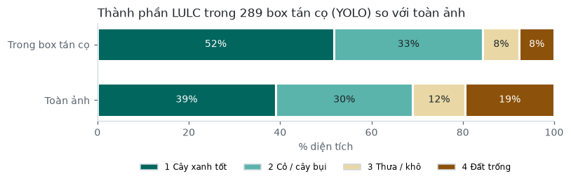
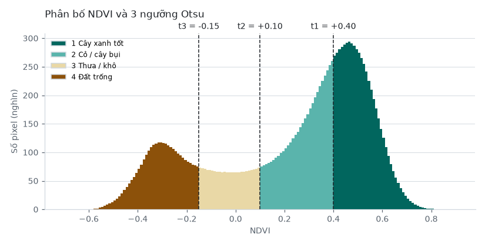

# QA nhánh phổ NDVI/NDRE & LULC — Quang Anh

Kiểm tra output của `scripts/03_spectral_ndvi_analysis.py` trên COG tái tạo bằng `scripts/01_gdal_cog_preprocessing.py`.

```bash
python scripts/03_spectral_ndvi_analysis.py   # sinh output
python scripts/qa_spectral.py                 # chạy QA (~8 s), mã thoát 0 = ĐẠT
```

Kết quả chi tiết: `data/outputs/spectral_qa.json`. Hình: `docs/figures/spectral_qa_*.png`.

**Kết luận: ĐẠT 18/18 kiểm tra.**

## 1. Diện tích

| Kiểm tra | Kết quả |
| :--- | :--- |
| Diện tích 1 pixel = \|ΔX·ΔY\| | 0,0413 × 0,0413 = 0,00170569 m² ✅ |
| Pixel phân lớp = mask − bão hòa − mẫu số 0 | 14 697 855 − 1 114 − 0 = **14 696 741** = JSON = raster ✅ |
| Số pixel từng lớp: JSON = đếm trên `lulc_class.tif` | 5 732 176 · 4 416 859 · 1 692 116 · 2 855 590 ✅ |
| Tổng hợp lệ = số pixel × diện tích pixel | 14 696 741 × 0,00170569 = 25 068,08 m² = **2,5068 ha** ✅ |
| Tổng diện tích 4 lớp = tổng hợp lệ | 25 068,09 vs 25 068,08 m² (lệch 0,01 do làm tròn từng lớp) ✅ |
| Tổng % ≈ 100 | 99,99 % (làm tròn) ✅ |

## 2. Nhất quán NDVI ↔ LULC

| Kiểm tra | Kết quả |
| :--- | :--- |
| NaN ở `ndvi.tif` ⇔ lớp 0 ở `lulc_class.tif` | 4 897 105 pixel, trùng khớp tuyệt đối ✅ |
| Phân lớp lại từ `ndvi.tif` với ngưỡng trong JSON | 0 pixel lệch ✅ |
| NDVI trong [−1, 1] | −0,663 … 1,000 ✅ |
| Otsu tính lại, làm tròn 0,05 = ngưỡng đang dùng | 0,397 / 0,109 / −0,174 → 0,40 / 0,10 / −0,15 ✅ |

## 3. Phổ trung bình từng lớp

DN trung bình (chưa hiệu chuẩn) theo lớp:

| Lớp | Blue | Green | Red | RedEdge | NIR | NDVI | NDRE |
| :--- | ---: | ---: | ---: | ---: | ---: | ---: | ---: |
| 1 Cây xanh tốt | 20 422 | 20 994 | **11 466** | 30 346 | **35 111** | 0,511 | 0,080 |
| 2 Thảm cỏ / cây bụi | 24 575 | 25 970 | 17 478 | 29 745 | 31 463 | 0,284 | 0,036 |
| 3 Thực vật thưa / khô | 25 494 | 24 597 | 22 223 | 21 557 | 21 163 | −0,025 | −0,001 |
| 4 Đất trống / đất lộ | 30 944 | 25 651 | **31 060** | 17 921 | **16 336** | −0,304 | −0,042 |



Kiểm tra (đều ✅):

- NDVI trung bình giảm dần 1 → 4: 0,511 > 0,284 > −0,025 > −0,304.
- Tỉ số NIR/Red giảm dần: 3,06 > 1,80 > 0,95 > 0,53.
- Lớp 1 có NIR cao nhất và Red thấp nhất → đúng đặc trưng thực vật (diệp lục hấp thụ đỏ, mô lá tán xạ NIR); "bước nhảy" Red → RedEdge rõ nhất (rìa đỏ).
- Lớp 4 có Red > NIR, Blue cao, đường phổ phẳng/giảm → đặc trưng đất trống; trên DN chưa hiệu chuẩn nên NDVI âm.
- Lớp 3 có phổ gần phẳng (Red ≈ RedEdge ≈ NIR) → hỗn hợp đất + thực vật khô, đúng vai trò lớp chuyển tiếp.
- NDRE lớp 1 > lớp 4 (0,080 > −0,042).
## 4. Đối chiếu NDVI với ảnh RGB

**Định lượng.** Tương quan giữa NDVI và chỉ số xanh chỉ dùng kênh nhìn thấy ExG = (2G − R − B)/(R + G + B), trên 500 000 pixel mẫu: **Pearson r = 0,638** ✅ — vùng NDVI cao trùng vùng "xanh" trên RGB.

**Trực quan** trên 3 vùng 700×700 px (≈ 29 × 29 m):



- *Đất trống tây bắc:* nền hồng/trắng trên RGB → lớp 4; các búi cỏ xanh lác đác → lớp 2–3; một cây cọ ở góc phải → lớp 1.
- *Vùng chuyển tiếp:* mảng đất hồng bên trái → lớp 4; tán cọ hình sao → lớp 1, rìa tán → lớp 2.
- *Rừng cọ:* tán dày → lớp 1 liền mạch; các khoảng trống lộ đất hồng → lớp 4.

## 5. Kiểm chứng độc lập bằng tán cọ YOLO (nhánh Hinh)

`detections.geojson` (289 box tán cọ, chỉ đọc) được chuyển sang EPSG:32630 và rasterize lên lưới LULC:



| | Lớp 1 | Lớp 2 | Lớp 3 | Lớp 4 |
| :--- | ---: | ---: | ---: | ---: |
| Trong 289 box tán cọ | **51,7 %** | 32,7 % | 8,0 % | **7,6 %** |
| Toàn ảnh | 39,0 % | 30,1 % | 11,5 % | 19,4 % |

- Lớp 1 + 2 chiếm **84,4 %** diện tích box ✅ (box là hình chữ nhật bao tán tròn nên phần góc box chứa nền — 15 % còn lại là hợp lý).
- Lớp 4 trong box chỉ 7,6 %, thấp hơn nhiều so với 19,4 % toàn ảnh ✅.

Hai nhánh làm bằng hai phương pháp khác nhau (học sâu trên RGB vs ngưỡng NDVI) nhưng cho kết quả nhất quán.

## 6. Histogram và ngưỡng



Ba ngưỡng rơi đúng vị trí: t3 ở sườn phải đỉnh đất, t2 ở cuối thung lũng giữa hai đỉnh, t1 ngay trước đỉnh thực vật.

## 7. Độ nhạy diện tích theo ngưỡng

Dịch **từng** ngưỡng ±0,05, đổi bao nhiêu điểm phần trăm (pp) diện tích:

| Ngưỡng | −0,05 | +0,05 | Lớp bị ảnh hưởng |
| :--- | :--- | :--- | :--- |
| t1 (0,40) | lớp 1 +8,3 pp | lớp 1 −9,5 pp | chỉ chuyển giữa lớp 1 ↔ 2 |
| t2 (0,10) | lớp 3 −2,4 pp | lớp 3 +2,7 pp | chỉ chuyển giữa lớp 2 ↔ 3 |
| t3 (−0,15) | lớp 4 −2,7 pp | lớp 4 +2,4 pp | chỉ chuyển giữa lớp 3 ↔ 4 |

- t2, t3 nằm ở vùng thưa pixel (thung lũng) → **ổn định** (±2–3 pp).
- t1 nằm sát đỉnh thực vật → **nhạy nhất** (±8–10 pp): ranh "cây xanh tốt / cỏ–cây bụi" là ranh mềm, nên báo cáo diện tích lớp 1 và 2 kèm sai số này; tổng thực vật (lớp 1 + 2) không đổi khi dịch t1.

## 8. Bóng đổ

5 % pixel tối nhất (tổng 5 band thấp nhất) rơi vào: lớp 1 45,3 % · lớp 2 29,6 % · lớp 3 16,5 % · lớp 4 8,7 %. Bóng chủ yếu nằm **trong tán** và vẫn được xếp vào lớp thực vật (NDVI là tỉ số nên ít bị ảnh hưởng bởi độ sáng). Chỉ ~9 % pixel tối rơi vào lớp đất → bóng không làm phình lớp 4 đáng kể.

## 9. Giới hạn còn lại

- DN chưa hiệu chuẩn phản xạ → NDVI tương đối; ngưỡng chỉ áp dụng cho COG này (tính lại bằng `--suggest-thresholds` nếu đổi dữ liệu).
- Chưa có ground truth thực địa → chưa có Overall Accuracy / Kappa; các kiểm chứng ở mục 4–5 là gián tiếp.
- Ranh lớp 1/2 nhạy với t1 (±8–10 pp / ±0,05).
- Phân lớp theo pixel → pixel mép tán dễ rơi vào lớp 2–3.

## 10. Thay đổi kèm theo

- Bảng màu `lulc_class.tif` đổi sang nâu–xanh ngọc (kiểu BrBG). Bộ xanh lá / nâu cũ có lớp 1 và lớp 4 gần như trùng màu với người mù màu đỏ–lục (ΔE ≈ 3,5); bộ mới có mọi cặp lớp ΔE ≥ 9,7 khi mô phỏng mù màu đỏ, lục, lam.
